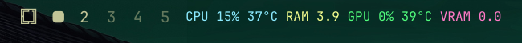

# System stats for the Omarchy bar

A bar widget for Omarchy that shows total CPU, RAM, GPU
and VRAM usage with CPU/GPU temperatures, each stat in its own colour. The
colours follow your Omarchy theme, or a palette you pick.



```
CPU 15% 37°C  RAM 3.9  GPU 0% 39°C  VRAM 0.0
```

- **CPU**: total busy percentage across all cores, and the package temperature
- **RAM**: memory in use (total minus available), in GB (binary, GiB)
- **GPU**: utilisation and temperature of the GPU; `GPU off` while a discrete
  GPU is asleep (it is not woken up just to be measured)
- **VRAM**: video memory in use, in GB (GiB)
- A temperature of 85 °C or more turns that stat red (your theme's urgent
  colour) **and** adds `!` after the temperature, so it does not rely on colour
- Stats that are not available on your machine are left out

## Install

```bash
omarchy plugin add https://github.com/alexmirkovic99-hue/omarchy-system-stats --enable
```

The widget lands in the right section of the bar. Move it with
`omarchy bar move io.github.alexmirkovic99-hue.system-stats --section left`
or from the bar's own layout tools.

`omarchy plugin add` installs the repository's current commit; review the code
before enabling it. Plugins run unsandboxed inside omarchy-shell.

## Using it

- **Click the stats** to open the panel:
  - **Palette** and **Omarchy themes**: choose the colours (see below)
  - **Hotkey**: optional shortcut that hides or shows the stats (see below)
  - **Collapse**: hides the stats and leaves a small chip button where
    they were
- **Small chip button**: left-click brings the stats back; right-click opens
  the panel
- To take the widget off the bar **completely**, disable the plugin:
  `omarchy plugin disable io.github.alexmirkovic99-hue.system-stats`
  (enable it again to bring it back)

## Configuration

Options are stored in the widget's entry in `~/.config/omarchy/shell.json`.
The panel sets `palette` and `collapsed`; the other two can be changed with
`omarchy bar set`:

| Key          | Default    | Meaning |
|--------------|------------|---------|
| `showTemps`  | `true`     | Show CPU and GPU temperatures (°C) |
| `intervalMs` | `2000`     | Refresh interval in milliseconds, 1000 to 10000 |
| `palette`    | `"system"` | `"system"`, `"fixed:<id>"` or `"theme:<name>"` (set from the panel) |
| `collapsed`  | `false`    | `true` shows only the small chip button |

```bash
omarchy bar set io.github.alexmirkovic99-hue.system-stats showTemps false --json
omarchy bar set io.github.alexmirkovic99-hue.system-stats intervalMs 5000 --json
```

## Colours and palettes

Each stat has its own colour: CPU, RAM, GPU, VRAM.

- **System (follows theme)**, the default: the active Omarchy theme's `blue`,
  `yellow`, `green` and `magenta` from
  `~/.local/state/omarchy/current/theme/colors.toml`. It changes with
  `omarchy theme set`, live.
- **Fixed palettes**: Dracula, One Dark, Solarized Dark, Monokai, GitHub Dark,
  Synthwave '84, Okabe-Ito (colour-blind safe), Tol Vibrant and Tableau 10.
  They do not change with the theme. They are made for dark backgrounds.
- **Omarchy themes**: the colours of any installed theme (stock themes in
  `/usr/share/omarchy/themes`, your own in `~/.config/omarchy/themes`),
  without switching to it. Your own themes are listed first, then the themes
  whose four colours are easiest to tell apart.

Notes next to a palette:

- `similar colours`: two of its four colours are hard to tell apart
- `low contrast`: at least one colour is below 3:1 contrast against the
  current theme's background (common for dark palettes on light themes)
- `custom`: one of your own themes

Theme files are only read, never changed. A colour that is not a plain
`#rrggbb` value is ignored.

## Keyboard

The panel works from the keyboard like the other Omarchy panels. Arrow keys
(or `h` `j` `k` `l`) move a highlight through the palette lists, the two
hotkey rows and **Collapse**; Left/Right move between a row's buttons;
Enter or Space activates; in an open list Up/Down move and Enter picks; Esc
steps back out of an open list or "Add how?" and then closes the panel; Tab
switches to another bar panel. The highlight appears with the first key press,
so using the mouse looks the same as before.

## Hotkeys (optional)

Two optional shortcuts, each with its own row in the panel's **HOTKEYS**
section:

- **Expand / Collapse**: the same as **Collapse** and clicking the
  small button
- **Open this menu**: opens the panel (palette, hotkeys, collapse)

Nothing is written to your Hyprland config until you press a button in a row.
**Add** asks how:

- **AUTO**: a free default shortcut is added straight away and kept free: if
  another shortcut later takes the same keys, it moves to the next free default
  (with a notification). A shortcut you chose yourself is never changed, and
  **Clear** stays cleared until you press **Add** again
- **MANUAL**: you press the shortcut you want (at least one of Super, Ctrl,
  Alt, Shift plus a key)

With a shortcut set, **Change** lets you press a new one and **Clear** removes
it. The buttons explain themselves when you hover over them.

The defaults tried for AUTO, in order: `SUPER + CTRL + M`, `SUPER + ALT + M`,
`CTRL + ALT + M`, `SUPER + CTRL + SHIFT + M` for expand / collapse, and
`SUPER + CTRL + U`, `SUPER + ALT + U`, `CTRL + ALT + U`,
`SUPER + CTRL + SHIFT + U` for the menu. None of them is an Omarchy default
binding.

Each shortcut is written as one marked block at the end of
`~/.config/hypr/bindings.lua`, the file Omarchy keeps for your own bindings:

```lua
-- >>> io.github.alexmirkovic99-hue.system-stats hotkey (managed by the System stats plugin; change or clear it from its panel) >>>
o.bind("SUPER + CTRL + M", "Expand or collapse System stats", "bash '/home/you/.config/omarchy/plugins/io.github.alexmirkovic99-hue.system-stats/toggle.sh' toggle")
-- <<< io.github.alexmirkovic99-hue.system-stats hotkey <<<
```

The menu shortcut has its own block, marked `hotkey-menu`, which runs
`omarchy-shell shell toggle <plugin-id> '{}'`. Both appear in the Omarchy
keybindings menu (SUPER + K). How the edits are kept safe:

- Everything outside the marked block is left exactly as it was; set followed
  by clear gives back the original file
- A shortcut already used by another binding is refused, and the panel says
  which one. Bindings Hyprland reports without a key name (Omarchy binds the
  workspace digits and some resize keys by key code) also block digits and
  symbols on the same modifiers. If Hyprland's bindings cannot be read (for
  example Hyprland is not running), nothing is written
- After writing, Hyprland is reloaded (`hyprctl reload`); if that produces new
  config errors, the previous file is put back
- A block whose marker lines were edited by hand is not touched; delete it
  yourself
- A symlinked `bindings.lua` stays a symlink, and file permissions are kept
- The panel warns if another binding later takes the same shortcut

`hyprctl reload` re-reads your whole Hyprland config, so settings you changed
at runtime with `hyprctl keyword` are reset, as with any config reload.

The same actions from a terminal:

```bash
~/.config/omarchy/plugins/io.github.alexmirkovic99-hue.system-stats/hotkey.sh get
~/.config/omarchy/plugins/io.github.alexmirkovic99-hue.system-stats/hotkey.sh set "SUPER + ALT + M"
~/.config/omarchy/plugins/io.github.alexmirkovic99-hue.system-stats/hotkey.sh mode auto     # Add > AUTO (or: mode manual, mode)
~/.config/omarchy/plugins/io.github.alexmirkovic99-hue.system-stats/hotkey.sh clear
# the same for the menu shortcut, with `menu` first:
~/.config/omarchy/plugins/io.github.alexmirkovic99-hue.system-stats/hotkey.sh menu set "SUPER + ALT + U"
```

The expand / collapse shortcut runs `toggle.sh toggle`. `toggle.sh` also has `show`, `hide`,
`delete` (take the widget off the bar, keeping its options and position for
a later `show`) and `status`.

## What it reads, writes and runs

Reads (never writes): `/proc/stat`, `/proc/meminfo`,
`/sys/class/hwmon/*` (CPU temperature), `/sys/bus/pci/drivers/nvidia/*/power/runtime_status`,
`/sys/class/drm/card*/device/*` (AMD GPU), the theme `colors.toml` files listed
above.

Writes:

| File | When |
|------|------|
| `~/.config/omarchy/shell.json` (this widget's entry only) | Choosing a palette, hiding/showing the stats, `toggle.sh delete`/`show` |
| `~/.local/state/io.github.alexmirkovic99-hue.system-stats/bar-entry.json` | `toggle.sh delete` saves the widget's options and position there |
| `~/.local/state/io.github.alexmirkovic99-hue.system-stats/hotkey.json` | For each hotkey: AUTO or MANUAL, and whether it came from a default or from you; written only when you use the hotkey buttons |
| `~/.config/hypr/bindings.lua` (the marked block only) | When you press Add, Change or Clear; for a hotkey you set to AUTO, also when its default is added or has to move |
| `$XDG_RUNTIME_DIR/omarchy-hotkeys.lock`, `$XDG_RUNTIME_DIR/<id>.toggle.lock` | Empty lock files; the runtime directory is cleared at logout |

Runs: `bash`, `timeout`, `awk`, `head`, `cat` and, if installed,
`/usr/bin/nvidia-smi` every refresh (default 2 s) to collect the stats; `jq`,
`flock`, `hyprctl`, `omarchy` and `omarchy-shell` for the hotkey and
show/hide. No network access, no background service, no root privileges.

## Requirements and compatibility

- Omarchy 4 (Quattro) with omarchy-shell. Developed and tested on Omarchy
  4.0.4 with Hyprland 0.56.2 and its Lua config (`bindings.lua`)
- `jq`, `flock` and `timeout`, which a standard Omarchy install already has
- NVIDIA GPU stats need `nvidia-smi` (part of the NVIDIA driver utilities)

| Hardware | Support |
|----------|---------|
| Intel CPU temperature | `coretemp` |
| AMD CPU temperature | `k10temp` (Tdie when the kernel provides it, else Tctl) or `zenpower` |
| ARM CPU temperature | `cpu_thermal` |
| NVIDIA GPU | `nvidia-smi`; shows `GPU off` while a laptop dGPU sleeps |
| AMD GPU | `amdgpu` sysfs (busy %, VRAM, edge temperature) |
| Intel GPU | Not shown |

## Known limitations

- Only one GPU is shown: NVIDIA if present, otherwise the first AMD GPU
- Intel integrated GPUs have no usage figure here
- Some Ryzen models report Tctl with a fixed offset when the kernel does not
  provide Tdie
- On a vertical bar the stats are stacked one stat per line; this layout has had
  little testing
- The hotkey recorder maps shifted symbols using the US layout; on other
  layouts prefer letters or F-keys
- Bindings made by key code are only detected for digits and symbols; a letter
  bound by key code elsewhere is not seen as a conflict
- The fixed palettes are designed for dark backgrounds (marked `low contrast`
  on light themes)
- The widget uses omarchy-shell's internal QML components (`qs.Ui`,
  `qs.Commons`), which may change between Omarchy releases

## Uninstall

1. If you set a hotkey, clear it first (panel → **Clear**, or
   `~/.config/omarchy/plugins/io.github.alexmirkovic99-hue.system-stats/hotkey.sh clear`).
   If the plugin is already removed, delete the lines from `-- >>> io.github.alexmirkovic99-hue.system-stats hotkey`
   to `-- <<< io.github.alexmirkovic99-hue.system-stats hotkey <<<` in
   `~/.config/hypr/bindings.lua` and run `hyprctl reload`.
2. Remove the plugin. This also takes the widget off the bar:

   ```bash
   omarchy plugin remove io.github.alexmirkovic99-hue.system-stats
   ```

3. Remove the saved options, if `toggle.sh delete` was ever used:

   ```bash
   rm -rf ~/.local/state/io.github.alexmirkovic99-hue.system-stats
   ```

The lock files in `$XDG_RUNTIME_DIR` disappear at logout. Nothing else is
left behind.

## Testing

From a checkout of this repository:

```bash
tests/run.sh
```

The tests use temporary files with fake `hyprctl` and `omarchy` commands and
never touch your real configuration. They need `bash`, `jq`, `node` and
`flock`.

## License

MIT, see [LICENSE](LICENSE). The fixed palettes are colour values from the
named colour schemes (sources are listed in `Model.js`).
